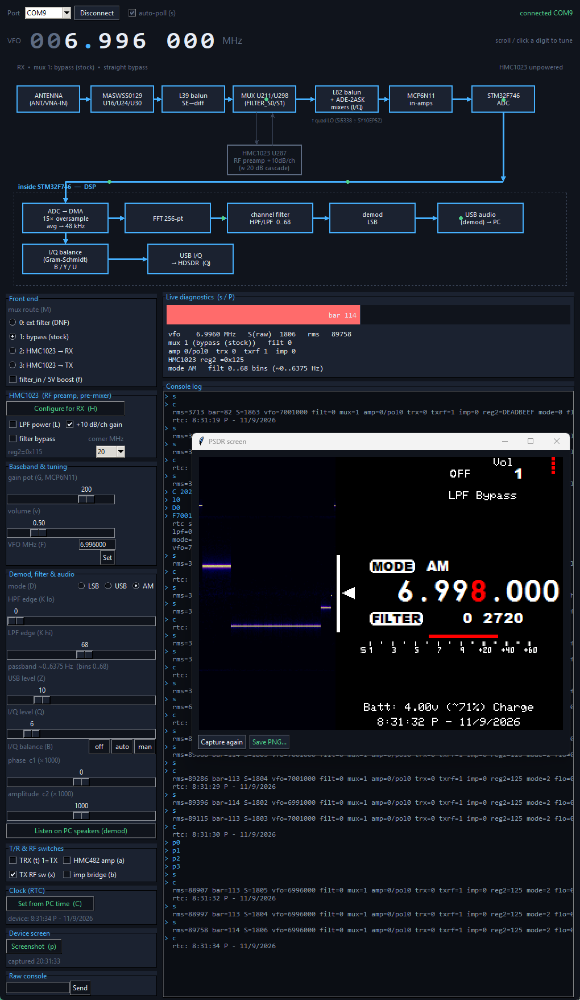

PSDR
====

PortableSDR - a stand-alone, pocket-sized HF software defined transceiver.
[Hackaday.io project page](https://hackaday.io/project/1538-portablesdr)

The PortableSDR is an open-source QRP (low-power) radio for ham operators, hikers, backpackers and DIY enthusiasts. It is a self-contained HF/shortwave SDR with its own display, battery, speaker and controls, and it carries the hardware for a vector network analyzer / antenna analyzer and GPS. It is meant to be a flexible platform for development, a learning aid, and a useful instrument.

## What's new (November 2026)

The firmware is being actively worked on again. `master` now holds the current STM32F746 firmware for the 2.6.1 board, with:

- **Working HMC1023 low-pass filter / RF preamp path**, with an on-device **LPF** setting: Bypass, 0 dB or +20 dB. *(Needs a small hardware modification: one wire to give U287 pin 28, `VDDBG`, its 5 V. Without it, leave the setting on Bypass, which is the default.)*
- **AM reception that works**, on the built-in speaker and over USB.
- **USB composite device**: plug the radio into a PC and you get
  - a **serial console** for control and diagnostics,
  - **"PSDR Demod"**, a sound card carrying the demodulated audio, and
  - **"PSDR I/Q"**, a stereo sound card carrying raw I/Q (48 kHz) for HDSDR, Quisk and similar.
- **A PC control panel** (`tools/psdr_panel.py`), shown below, including a button that captures the radio's own screen.
- **Real-time clock**: time and date on the display, kept running from the battery.
- **Battery voltage, percentage and charge status** on the display.
- **A real "off"**: low-power sleep that wakes on the knob, and the radio remembers frequency, mode, filter, volume and LPF setting.
- **Faster display**: screen fills go out over DMA (about 22x faster than before).
- Cleaner sampling: all three ADCs are DMA-driven at a true 48 kHz with 15x oversampling.
- A command-line build (`build.sh`), so no IDE is needed.



*The control panel talking to a radio over USB. The "PSDR screen" window is a live capture of the radio's LCD, taken with the panel's Screenshot button.*

## Control panel

```
pip install pyserial
python tools/psdr_panel.py
```

It finds the radio's serial port automatically and gives you a large tuning readout, the receive signal chain as a diagram, mode and filter controls, level meters, "Listen on PC speakers" (needs ffmpeg/ffplay), "Set from PC time" for the clock, and **Screenshot**, which reads the radio's LCD back and shows it in a window you can save as a PNG. `tools/shot.py` does the same capture from the command line.

## What works today

| Area | Status |
|---|---|
| Receive, LSB / USB / AM | Working |
| Waterfall display, S-meter, adjustable filter | Working |
| USB serial console, demod audio, I/Q audio | Working |
| HMC1023 filter / preamp path | Working with the `VDDBG` wire; Bypass otherwise |
| Clock, battery and charge display, sleep with saved state | Working |
| Transmit | Hardware is there; not re-tested with the current firmware |
| CW (keyer, narrow filter, decode) | Not implemented |
| Vector network analyzer / antenna analyzer | Hardware is there (AD8302 + bridge); no firmware yet |
| GPS, MicroSD | Hardware is there; no firmware yet |

Receive sensitivity is modest (a signal is just visible on the waterfall at around -100 dBm). Improving it is the main open hardware question; see `docs/REVIEW.md` and `docs/NEXT-REV-IDEAS.md`.

## Hardware (board 2.6.1)

- STM32F746 ARM Cortex-M7
- 320x240 color LCD
- Si5338 clock synthesizer driving quadrature LO dividers
- Direct-conversion receiver and exciter using diode-ring mixers
- HMC1023 programmable low-pass filter / gain stage ahead of the mixers
- Digitally controlled instrumentation amplifiers
- Morse key (the "Giblet" on the bottom right corner of the enclosure) and paddle inputs
- Magnitude and phase measurement chip with impedance bridge (for VNA and antenna analysis)
- Dual SMA connectors, smartphone-style earphone/microphone connector, USB
- GPS, MicroSD slot
- Built-in microphone and speaker
- Internal lithium polymer battery with charger
- Pads for raw I/Q signals, in and out

Design files are in `Hardware/` (PADS originals, BOMs, schematic PDF) and `dist/kicad/` (a KiCad schematic generated from the PADS netlist).

## Building and flashing the firmware

The firmware is in `Source/`. On Windows with STM32CubeIDE installed (for its bundled GNU ARM toolchain):

```
bash build.sh
```

This produces `build/PSDR_F7.elf`, `.hex` and `.bin`. The toolchain path is set at the top of `build.sh`; edit it for your install. Flash over SWD with an ST-Link, for example:

```
STM32_Programmer_CLI -c port=SWD -w build/PSDR_F7.bin 0x08000000 -v -rst
```

Back up your radio's existing firmware first (`STM32_Programmer_CLI -c port=SWD -u 0x08000000 0x100000 backup.bin`) so you can always go back.

## Repository layout

| Path | Contents |
|---|---|
| `Source/` | Firmware (STM32F746) |
| `tools/` | PC control panel, screenshot tool, PADS-to-KiCad scripts |
| `docs/` | Bench notes, design review, wishlist, next-revision ideas |
| `Hardware/` | PADS design files, BOMs, schematic PDF |
| `dist/` | Generated KiCad schematic and netlists |

Older lines of development are kept as tags: `archive/master-F4` (the original STM32F4 firmware), `archive/PSDR_F7`, `archive/PSDR_Rebuild` and others.

## Why did I make it?

I'm an avid backpacker and radio enthusiast. To me there is something exciting about making contact with others from remote locations where cell phones and the internet can't reach. I wanted an advanced radio that was ideally suited to tough environments. That meant it needed to be very compact, integrated, and durable. As an engineer, I wanted an open platform that really takes advantage of the hardware and has the potential to grow and be used for other applications.

There are numerous, excellent radios out there, but none offered the combination I wanted. The best radios are closed source, larger, and expensive, while most open designs are very basic and lacking in flexibility.

## Contributing

Please read [CONTRIBUTING.md](CONTRIBUTING.md) for ways to help keep this project going. The project is MIT licensed; see [LICENSE.md](LICENSE.md).
